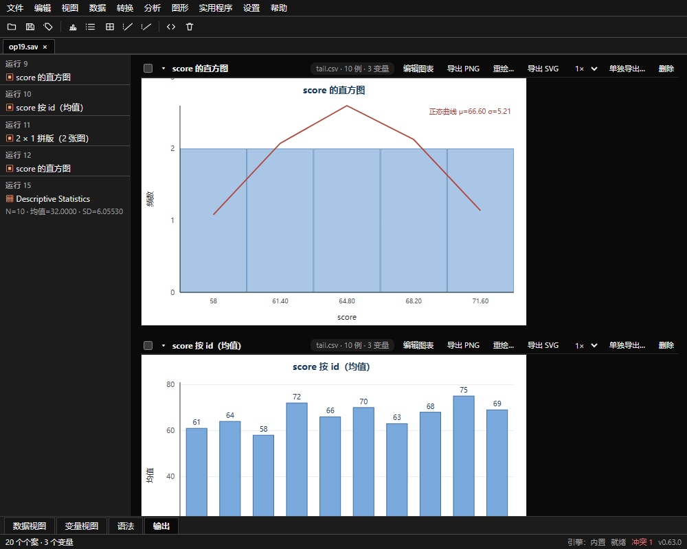
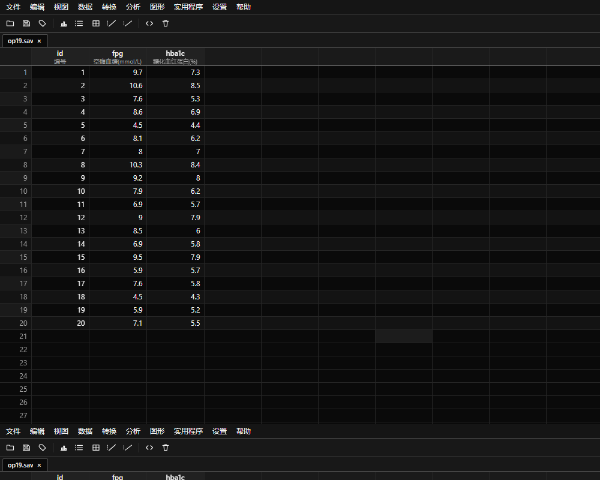
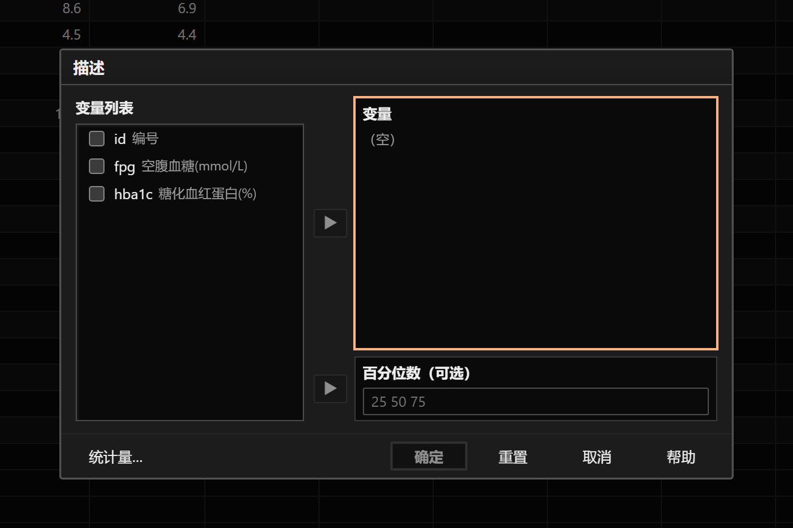
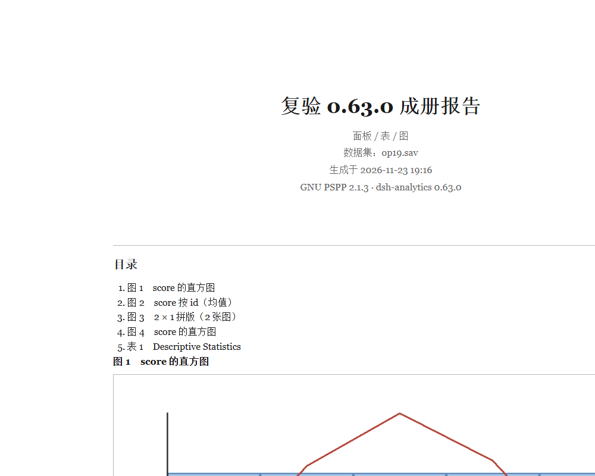

# dsh-analytics

PSPP 作为 DeepSeek Harness 插件自带引擎的统计分析工作台：**不连接系统里另装的 PSPP**，插件目录里自带一份可搬迁的 PSPP 引擎（`engine/<平台>-<架构>/`，本机 `engine/linux-x64/` 23 MB，已实测在屏蔽 `/usr/lib64/pspp` 与 `/usr/share/pspp` 后仍能运行）。

界面在 DSH 原生右侧栏里以 **统计分析** 标签页出现（通过 `dsh-better-sidebar` 的 `registerTab` 注册），按 SPSS 的操作范式组织：菜单栏 + 工具栏 + 数据视图 / 变量视图 / 语法 / 输出查看器 + 分析对话框。名字里的 analytics 说的是用途，真正干活的是自带的 GNU PSPP 引擎。

## 界面

以下截图取自 Windows 10 上的真实 DSH（暗色皮肤），面板本身跟随宿主主题。

| 输出查看器（含表注与图） | 数据视图 |
| --- | --- |
|  |  |

| 分析对话框（描述统计） | 报告成册生成的 HTML（封面 + 目录） |
| --- | --- |
|  |  |

更多界面图（菜单、各类对话框、图表、值标签等）在 [docs/screenshots](docs/screenshots)。

## Requirements

- DeepSeek Harness **>= 0.2.0**（`package.json` 的 `engines.dsh` 声明了这个范围；低于它的宿主会在安装时就拒绝）
- Node.js **>= 20**（插件零运行时依赖；`npm test` 是自带脚本 + `node:assert`，其中 smoke/routes 两套要能跑起 PSPP 引擎）
- 一个带 `dsh-better-sidebar` 的 profile：侧栏页签靠它的 `registerTab` 注册，`peerDependencies` 里是可选依赖
- 引擎：插件自带预编译 PSPP，**不需要**系统装 PSPP；本机平台没有 `engine/<platform>-<arch>/` 时按 `npm run engine:fetch` 从 `engine-v*` Release 拉，或回退到系统 `pspp`

面板支持中文与英文两套界面（设置 → 统计分析 → 界面语言），分析输出的表头与数据值保持原样。

## 安装

包自带 `engine/linux-x64` 与 `engine/win32-x64`（约 34 MB），一条命令装（0.27.0 起）：

```bash
git clone https://github.com/qzhengpyuan/dsh-analytics.git && cd dsh-analytics
node scripts/install.mjs web            # 下最新 Release 的 .tgz、按 SHA256SUMS 校验、打印要执行的两步
node scripts/install.mjs web --apply    # 真的装：装进 profile + 把 dsh-analytics-pspp 加进 dsh.profile.bundles
# 之后：设置 → 插件 → dsh-analytics 关一次再开
```

- 仓库已公开（2026-11-18 起），一条命令安装不再需要 token；脚本仍会在有 `GITHUB_TOKEN` / `~/.dsh/.credentials.yaml` 的 `refs.GITHUB_TOKEN` 时带上它（撞上 GitHub 的匿名限流时更稳）。
- 走代理时加 `NODE_USE_ENV_PROXY=1`（Node 的 `fetch` 默认不读 `https_proxy`）。
- 想手动装：`dsh plugin --profile <profile> add file:<tgz>`，再把 `"dsh-analytics"` 加进 `~/.dsh/profiles/<profile>/package.json` 的 `dsh.profile.bundles`。
- 这个包**没有发到 npm**：`dsh-analytics` 这个名字在 npm 上已被别的包占用（0.4.0），换名字只会把文档拆成两份。

`linux-x64` 与 `win32-x64` 是实测平台；`linux-arm64`、`darwin-arm64`、`darwin-x64` 的引擎在 `engine-v1` 里有 CI 产物，但**没有真机验证**。细节与检查清单见 [docs/install.md](docs/install.md)。

## 它由两半组成

| 半边 | 文件 | 职责 |
| --- | --- | --- |
| Host | `index.js`、`lib/*.js` | 自带引擎的进程管理、每会话工作区、数据读写、输出解析、`/analytics` HTTP API，并把工作区注册成 `analytics` 服务 |
| 预设半 | `tools-entry.js` | 27 个 `pspp_*` 工具，只挂在「统计分析」Agent 预设里，别的会话拿不到 |
| Client | `client.js` | 通过 `ctx.betterSidebar.registerTab()` 注册侧栏页签；所有请求走同一套 API |

面板的设置页（设置 → 统计分析）管个案上限、超时、`--safer` 与表格样式，写 `~/.dsh/analytics/settings.json`，不用改 profile patch；`registerTools` 那一项仍属部署决定，只展示。

Host 与 UI 共用**同一组 `Workspace` 方法**，所以"用户在对话框点确定"和"模型在对话里调 `pspp_analyze`"执行的是同一条代码路径，状态不会分叉。

## 引擎

- 目录布局：`engine/<process.platform>-<process.arch>/{bin,libexec,lib}`，每个平台一份预编译产物；`bin/` 是设好动态库搜索路径的启动器，`libexec/` 是真正的二进制
- 解析顺序：`config.engineDir` → 环境变量 `DSH_ANALYTICS_ENGINE`（旧名 `DSH_ANALYTICS_PSPP_ENGINE` 仍认）→ 包内 `engine/<平台>-<架构>/` → 包内扁平 `engine/` → 系统 `pspp`；动态库变量按平台选（Linux `LD_LIBRARY_PATH`、macOS `DYLD_LIBRARY_PATH`、Windows `PATH`）
- 生成：`npm run engine:fetch`（从 `engine-v*` Release 拉本机平台那份，需要时用 `GITHUB_TOKEN` / `~/.dsh/.credentials.yaml`）、`node scripts/bundle-engine.mjs --from-prefix <prefix> --platform linux-x64`（导入容器里 configure 出来的 prefix），或 `npm run bundle-engine`（从本机 `dnf install pspp` 直接抓）
- **`engine/` 不进 Git**（二进制）：克隆后按需重建；运行插件本身不需要系统装 PSPP
- 打包时**跳过 glibc 家族**（libc/libm/libpthread/…）改用宿主 glibc：把发行版 glibc 塞进 `LD_LIBRARY_PATH` 在别的系统上会直接崩。所以引擎的最低 glibc = **构建机**的 glibc；仓库里的这份是在 **AlmaLinux 8（glibc 2.28）** 上重编的，覆盖 RHEL/Alma/Rocky 8+、Ubuntu 18.10+、Debian 10+、openSUSE Leap 15+（旧版 Fedora 44 编译产物要求 2.43，仅 Fedora 44 能跑，已弃用）
- 引擎能力：PSPP 2.1.3 的实现范围（`FREQUENCIES` `DESCRIPTIVES` `CROSSTABS` `T-TEST` `ONEWAY` `GLM` `CORRELATIONS` `REGRESSION` `LOGISTIC REGRESSION` `FACTOR` `RELIABILITY` `NPAR TESTS` `EXAMINE` `MEANS` `CTABLES` `ROC` `QUICK CLUSTER`、数据管理与宏、`GRAPH /BAR` `/HISTOGRAM` `/SCATTERPLOT`），以及任意 `pspp_run` 语法
- 已知 PSPP 缺口（插件无法提供）：`DISCRIMINANT` `GGRAPH` `UNIANOVA/MANOVA` `MIXED` `SURVIVAL/KM` `TREE/CHAI` `REPORT` `MDS/PROXSCAL` `TWOSTEP` `CORRESPONDENCE` `PPLOT`，图表缺少 `PIE`/`LINE`

## 图表

条形图 / 直方图 / 散点图 / 箱线图 / 折线图 / 饼图**不由 PSPP 出图**：插件用内存里的数据集自己聚合（均值/总和/计数、等宽分箱、抽样），再由 `lib/charts.js` 渲染成 SVG 存进运行目录（`runs/<n>/chart.svg` + `chart.json`），面板与 agent 拿到的是同一张矢量图。

- 箱线图带五数概括、1.5×IQR 须线与离群点；折线图按分类变量的聚合值连线；饼图带右侧图例（含百分比）
- 好处：任意缩放不糊、配色统一、可被 `pspp_chart` 工具直接返回结构化数据
- 仍然走 PSPP 的情形：用户在语法视图里手写 `GRAPH …` 或 `FREQUENCIES /BARCHART`，那类图仍是 PSPP 的 PNG（样式固定、不能改）

## 数据模型

- 打开 `.sav` / `.por` 时复制一份到 `~/.dsh/analytics/<sessionId>/work.sav` 作为工作副本，原始文件不动
- `.csv` / `.txt` / `.tsv` 自动推断类型后导入
- 变量字典来自 `DISPLAY DICTIONARY`（名称、标签、测度、格式、缺失值、值标签）
- 数据页通过 `SAVE TRANSLATE /TYPE=CSV` 读出并分页提供给网格；默认上限 20 万行（`config.maxRows`）
- 写回：内存模型 → CSV → `GET DATA /TYPE=TXT` + `VARIABLE LABELS`/`VALUE LABELS`/`MISSING VALUES`/`VARIABLE LEVEL` → `SAVE OUTFILE`

## HTTP API（前缀 `/analytics`）

`api/state` `api/active` `api/open` `api/new` `api/rows` `api/output` `api/history` `api/run` `api/save` `api/saveSyntax` `api/export` `api/exportDoc` `api/exportOffice` `api/exportReport` `api/merge` `api/cell` `api/case` `api/paste` `api/variable` `api/sort` `api/flip` `api/find` `api/replace` `api/clear` `api/close` `api/convert` `api/sheets` `api/upload` `api/dir` `api/readFile` `api/writeText` `api/valuelabels` `api/mrset` `api/chart` `api/pairwise` `api/partial` `api/publication` `api/artifact` `api/chart/update` `api/chart/export` `api/report`
所有请求经 `ctx.connection.requestRejection()` 做宿主同源的 Host/Origin 与浏览器认证检查。

## 数据编辑与联动

- 数据视图：双击单元格改值；**键盘导航** ↑↓←→ 移动、Tab 横向移动、Enter/F2 进入编辑、Delete 清空、Esc 取消；「数据」菜单支持插入变量（对话框可设类型/宽度/小数/标签/值标签/缺失值/测量级别）、插入个案、删除个案、排序个案（升序/降序）、转置（走 PSPP `FLIP`）
- 变量视图：类型/宽度/小数/标签/测量/对齐就地编辑，× 删除变量；「值」列点开值标签编辑器（每行 `值=标签`），保存后数据视图立刻显示标签；「缺失」列可直接输入（空格分隔，数值/字符串均支持），写入 `MISSING VALUES`
- 合并文件（「数据 → 合并文件」/`pspp_merge`）：添加个案走 `ADD FILES`，按关键变量合并走 `MATCH FILES /BY`，结果写回工作文件
- 数据变更在原文件之外进行：存到 `work.sav`，只有点「保存」才会写回你打开的路径
- 输出菜单：每张表格右上角「复制 CSV / 下载 CSV」；「文件 → 导出表格为 CSV…」把所有表格拼成一个文件；「导出输出为 HTML…」连表格与图表打包成一个本地文件；「导出输出为 PDF…/ODT…」把最近一次运行重放成可打印文档（`pspp_export_document`）
- **对话联动**：面板和对话里的 agent 共用同一个会话工作区；agent 用 `pspp_*` 工具改了数据或产出新表格后，面板在 3 秒内刷新并提示「PSPP 有新输出」

## 分析对话框

每个分析/转换对话框都是 SPSS 式的两栏布局：左侧是变量列表，右侧是一组目标框（因变量、自变量、分组变量……）。点右栏某框让它成为活动框，再点左侧变量把它移入/移出该框；选中项在框里显示成可点的 chip。

标题行下方的「统计量… / 选项… / 图表… / 单元格… / 事后检验…」按钮打开嵌套的选项面板，勾选项直接映射到 PSPP 子命令：

| 过程 | 选项组 → 语法 |
| --- | --- |
| 频率 | 统计量 → `/STATISTICS=MEAN STDDEV …`；百分位 → `/PERCENTILES=`；图表 → `/BARCHART` `/HISTOGRAM` |
| 描述 | 统计量 → `/STATISTICS=MEAN STDDEV MIN MAX SEMEAN VARIANCE RANGE SKEWNESS KURTOSIS SUM` |
| 交叉表 | 统计量 → `/STATISTICS=CHISQ PHI CC LAMBDA GAMMA`；单元格 → `/CELLS=COUNT ROW COLUMN EXPECTED` |
| 探索 | 绘图 → `/PLOT=BOXPLOT HISTOGRAM NPPLOT` |
| 平均值 | 单元格统计 → `/CELLS=` |
| 独立样本 T | 选项 → `/CRITERIA=CI(.95)` |
| 单样本 T | 检验值 → `/TESTVAL=`；选项 → `/CRITERIA=CI(.95)` |
| 单因素 ANOVA | 统计量 → `/STATISTICS=DESCRIPTIVES HOMOGENEITY`；事后 → `/POSTHOC=TUKEY LSD BONFERRONI` |
| 相关 | 选项 → `/PRINT=TWOTAIL\|ONETAIL NOSIG`、`/MISSING=PAIRWISE\|LISTWISE` |
| 回归 | 统计量 → `/STATISTICS=R COEFF ANOVA CI` |
| 因子 | 输出 → `/PRINT=INITIAL EXTRACTION KMO`；旋转用字段下拉 |
| 非参数检验（8 个） | 卡方 `/CHISQUARE=VAR /EXPECTED=EQUAL`、二项式 `/BINOMIAL(.5)`、K-S 正态性 `/K-S(NORMAL)`、游程 `/RUNS(MEDIAN)`、Wilcoxon `/WILCOXON`、符号 `/SIGN`、Mann-Whitney `/MANN-WHITNEY … BY`、Kruskal-Wallis `/KRUSKAL-WALLIS … BY`、Friedman `/FRIEDMAN` |

细节约定：

- 变量列表按当前活动框的类型过滤：需要数值的框（检验变量/因变量）会把字符串变量置灰，需要分组的框接受任意类型
- 「组值」框会从该分组变量的值标签或已加载的个案里生成可勾选项（最多选两个），没有可选值时退回手填
- 图形菜单的条形图/直方图/散点图与统计对话框共用同一套两栏布局
- 输出区的宽表自动横向滚动、字号压到 11px；图表点击可放大，标题栏「关闭」退出

PSPP 2.1.3 的语法差异：`REGRESSION /STATISTICS=TOL`（含 `ALL`）会报「没有找到有效数据」并 rc=1，所以回归只发 `R COEFF ANOVA CI`；`RELIABILITY /STATISTICS` 尚未实现，可靠性对话框只发 `/SCALE('all') ALL /MODEL=ALPHA`。

## Agent 工具

26 个，**由插件自带的「统计分析」Agent 预设挂载**（`preset-analytics` → `dsh-analytics/tools`）：新建会话时选「统计分析」，这些工具才出现在那个会话里；用别的预设的会话看不到它们，省下的正是这 26 条工具定义每次请求都要占的上下文。宿主半在 `index.js` 里把工作区注册成 `analytics` 服务，预设半据此拿同一个数据集，所以面板和对话永远改的是同一份数据。想让老装法（每个会话都带工具）继续工作，把 `cordis.patch.yml` 里 `analytics` 行的 `registerTools` 改成 `true`。

27 个：`pspp_status` `pspp_open` `pspp_new` `pspp_add_variable` `pspp_append_cases` `pspp_variables` `pspp_data` `pspp_run` `pspp_run_file` `pspp_convert` `pspp_analyze` `pspp_transform` `pspp_chart` `pspp_publication_table` `pspp_pairwise` `pspp_partial` `pspp_cox` `pspp_discriminant` `pspp_cluster` `pspp_timeseries` `pspp_edit_chart` `pspp_save` `pspp_merge` `pspp_export_document` `pspp_export_office` `pspp_export_chart` `pspp_export`

- `pspp_analyze`：frequencies / descriptives / crosstabs / ttest_independent / ttest_paired / ttest_one_sample / oneway / glm / correlation / regression / logistic / factor / reliability / npar（卡方）/ npar_binomial / npar_ks / npar_runs / npar_wilcoxon / npar_sign / npar_mannwhitney / npar_kruskal / npar_friedman / examine / means / ctables / roc / cluster（npar 子过程与「分析 → 非参数检验」对话框生成同一份语法）
- `pspp_transform`：compute / recode / sort / aggregate / select / filter / weight / split / rename / delete / sample / count / rank（全部写回数据集）
- `pspp_run`：任意 PSPP 语法，返回表格矩阵、图表文件路径与诊断

## 配置（profile 的 `cordis.patch.yml` 覆写 `analytics` 行）

```yaml
- id: analytics
  config:
    engineDir: /path/to/pspp-engine   # 可选，覆盖包内 engine/（也可直接指向某个平台目录）
    dataDir: /path/to/dsh-home        # 可选，默认 ~/.dsh
    maxRows: 200000
    timeoutMs: 120000
    safer: false
    evictIdle: true      # 关掉后会话数据集常驻内存
    maxIdleMs: 1800000   # 空闲多久释放（毫秒）
    registerTools: false # true = 回到 0.26 之前的做法：每个会话都挂 27 个 pspp_* 工具
```

`registerTools: false`（默认）时工具只由预设半 `dsh-analytics/tools` 提供，也就是只出现在选了「统计分析」预设的会话里。它会被记进启动日志：`[dsh-analytics] <版本> routes ready (registerTools=false)`。

## 性能与规模（实测，2026-11-14，测试机：Fedora 44 x86-64 / 32 GB 内存）

| 场景 | 时间 | 备注 |
| --- | --- | --- |
| 导入 1 万例 × 7 变量 CSV | 473 ms | 含类型推断与写回 .sav |
| 导入 5 万例 CSV | 1400 ms | — |
| 1 万例 FREQUENCIES / CROSSTABS+CHISQ / DESCRIPTIVES / 回归 | 237 / 146 / 143 / 142 ms | 单次引擎调用 |
| 5 万例另存 .sav | 1108 ms | 2.6 MB |
| 5 万例 .sav 重新打开 | 709 ms | 个案数与数值逐位一致 |
| 27 张表 + 2 张图导出 .docx | 573 ms | 10.9 MB（含一张 4135 行的频率表） |
| 同上导出 .xlsx（含隐藏数据页） | 591 ms | 8.5 MB，29 张工作表，LibreOffice 无 `Err:`/`#NAME` |
| 3 个会话并发各跑一次回归 | — | 各自独立运行目录，互不干扰 |

- `maxRows` 默认 200000：超过就截断并在状态里标 `truncated`。
- `timeoutMs` 默认 120000：单个引擎进程的上限，超时按失败处理。
- 矩阵超过 500 行的表会自动附注（多半是把连续变量放进了频率表），导出 Word 会因此很大；这类表请改用描述统计。
- 会话内存：`WorkspaceRegistry` 每 30 分钟释放一次没被访问、也不在屏幕上的会话数据集（磁盘文件不动，下次请求自动重开）；`config.evictIdle: false` 可关掉。

## 与 SPSS 的对应

`docs/FEATURES.md` 第 14 节按 SPSS 的菜单路径列了对照表（哪一项在这里点哪里、是原生支持、换个名字、插件自算，还是引擎支持但面板没开放）。第 13 节把「已知限制」逐条对着引擎实测过一遍，每条都附引擎原文，方便用同样的命令复核：PSPP 2.1.3 自己没实现的是生存分析、判别分析、混合/多变量模型、决策树、数据重构（`CASESTOVARS`/`VARSTOCASES`）、时间序列、多重插补、复杂抽样、曲线估计、对数线性、多维标度；偏相关与多选题由插件自己算。转置（`FLIP`）只保留数值列，字符串列的内容会被丢掉，所以面板会先拦一次。

## 已知取舍

- 「选择个案」用 `SELECT IF` + 保存实现，不满足条件的个案会被真正删除（SPSS 是临时过滤）；对话框里已标注
- 转置沿用 PSPP `FLIP`：字符串列会变成 0/1 编码列，变量名变为 `VAR000…`
- 撤销按「一次编辑一步」记录，内存预算默认 4 000 000 个单元格（`historyBudgetCells`），超出后丢最早的那几步并在状态栏提示；查找/替换支持限定变量，输出窗口另有独立的搜索框（Ctrl+F）
- 曲线估计（`CURVEFIT`）在 PSPP 2.1.3 里只解析不执行（`CURVEFIT尚未实现`），因此没有对应对话框；曲线拟合请用 `COMPUTE` + `REGRESSION` 或 `pspp_run` 写公式
- 界面语言覆盖「菜单/对话框/提示/通知/面板表注前缀/Word-Excel 导出外壳」（`locale/en.json`，1292 条，含 `{0}` 模板）；**表注正文**（按数据算出来的说明，例如「期望频数不足」「方差不等」）与**长段错误解释**仍由宿主拼中文——它们含具体数字与变量名，整句翻译会失真，所以英文界面下这些正文保持中文，前缀与外壳跟语言走。
- 翻译规则是「整串命中 → `{0}` 模板 → 原样返回」，**没有**「把词典里的短词挨个塞进句子」这条兜底：那条规则会把长句切碎成 `Homogeneity of variance test的 p < 0.001` 这种半汉半英。查不到就整句保持中文，读起来至少是通顺的
- 面板的 HTTP 接口（`/analytics/api/*`）跟着宿主一起走 DSH 自己的鉴权；其中 `api/version` 在插件层不查 cookie，但宿主更外层的 `/api` 围栏仍然挡（实测不带 cookie 仍是 `401 unauthorized`），带 cookie 时只回 `{ok, plugin, version}`。其余接口：浏览器必须持有宿主启动时打印那条带 `?token=` 的地址换来的 cookie（`dsh-auth-<hash>`，30 天）。直接手敲 `http://127.0.0.1:<端口>/analytics/api/state` 会得到 `401 unauthorized` —— 这是宿主行为，不是插件在要求登录；错过那条 URL 时重开一次 `dsh web` 会打印新的地址

## 开发

```bash
npm test                     # build（纯函数）+ engine（平台解析）+ client（jsdom 挂 bundle）+ smoke + routes
npm run doctor               # dsh-plugin-toolkit 的九项清单检查（engines.dsh / files 覆盖 / 根导出等）
npm run verify:pack          # 打 tarball → 装进临时目录 → 确认装完的副本里有面板代码（跳过 mount；需 npm ≤ 11，见下）
npm run engine:fetch         # 拉本机平台的预编译引擎（engine-v* Release）
node scripts/bundle-engine.mjs   # 本机从源码重建自带引擎
npm pack                     # 打 tgz（含 engine/）
```

### 用 dsh-plugin-toolkit 检查

`npm run doctor` 与 `npm run verify:pack` 跑的是 [`dsh-plugin-toolkit`](https://github.com/WJDdidi-1/dsh-plugin-toolkit) 的检查：九项清单（`version` 语义化、`engines.dsh`、README 的 Requirements 段、`dsh.bundle.patch` 与其文件、`dsh.client` 与 client 入口、`files` 是否覆盖 exports/patch/client、根导出是不是带 `apply` 的插件）以及"打包后真装一遍"。CI 里两者都跑，见 `.github/workflows/test.yml`。

⚠️ `verify` 读 `npm pack --json` 的输出：npm 12 返回的是按包名索引的对象，工具按早期版本的数组解析，会报 `object is not iterable`。本地 npm 12 想跑它，得在 PATH 前面挂一份 npm 11（`npm i --prefix /tmp/npm11 npm@11` 后用 `PATH=/tmp/npm11/node_modules/.bin:$PATH` 执行）；CI 的 node 20/22 自带 npm 10/11，不受影响。

它的 `verify` 默认还会把面板挂到 jsdom 里，但这一步对**本插件不成立**：我们的界面是 `dsh-better-sidebar` 的页签，而工具内置的 stub host 没有 `betterSidebar` 服务，挂载必然报 "registered nothing"。所以 CI 用 `--no-mount`，客户端那一半改由 `test/client.mjs` 覆盖——它自带一个提供 `betterSidebar` 与 `sidebarRight` 的 host，把 `registerTab` / `registerFileViewer` 的登记、菜单栏渲染、空工作台不显示标签条、以及"文件面板转交后关掉自己的中转标签"都断言了一遍。

### 改了代码之后怎么生效

| 改的是 | 生效方式 |
| --- | --- |
| `client.js`（面板界面） | 刷新页面即可；`npx dsh-plugin-toolkit dev .` 会在拷过去之后自动重载 |
| `lib/*.js`、`index.js`、`cordis.patch.yml` 的配置（后端一半：工具、路由、引擎调用） | `plugin_manager` 的 disable → enable 即可，**不用重启**：宿主自带的 `dsh-hmr` 在重载时会比对已加载模块的 `ino:size:mtime`，改过的模块被剔出 ESM 缓存后重新求值。Linux 与 Windows 两端实测都成立（2026-11-14 Windows 用 `pspp_status` 的 `plugin.version` 复核过）。前提是**改完再等一下再重载**——插件目录若走 SMB 链接（如 `link:Z:\work\dsh-analytics`），Windows 重定向器会缓存远程文件元数据约 10 秒，太快重载会读到旧 mtime、判定「没变」 |

面板的 `client.js` 由宿主从磁盘读取，改完**刷新页面**就是新的；后端的版本号读的是每次现读的 `package.json`（0.23.8 起不再用模块缓存的 JSON），所以 `plugin.version` 变化等于后端模块真的换过。

判断跑的是哪一版：面板状态栏右下角显示 `v0.23.14` 这样的版本号，`pspp_status` 的返回里也有 `plugin.version`；两者都对得上才说明新代码真的在跑。宿主日志里每次装载会打一行 `[dsh-analytics] <版本> routes ready`。

还想在跑着的应用里看改动时，用它的 `dev`：

```bash
npx dsh-plugin-toolkit@latest dev . --host http://127.0.0.1:3080
```

它把 `client.js` 拷到运行中的 profile 并靠 `/plugins/events` 的 `rebuilt` 帧确认真的重载了（改完刷新页面即可，不用重启 dsh）。

### CI 的一个坑

`test.yml` 带 `paths-ignore`，而 GitHub 对**没有父提交的 push**（重写历史后第一次推）算不出 diff，于是这条工作流不会自动跑。改完历史的那一版要么手动触发（`gh workflow run test.yml --ref master`），要么随便推一个有实际改动的提交。`build-engine.yml` 不吃路径过滤，所以 `engine-v*` 标签被移动时会真的重跑一次引擎构建。

安装、依赖矩阵、打 tgz（自带引擎版 / 通用版）、卸载与引擎重建见 [docs/install.md](docs/install.md)。

## 许可

- 本插件代码：MIT（`LICENSE`）
- 内置引擎：GNU PSPP，GPLv3+（`engine/<平台>/COPYING`、`NOTICE`），源码对应 GNU PSPP 2.1.3 发布包
